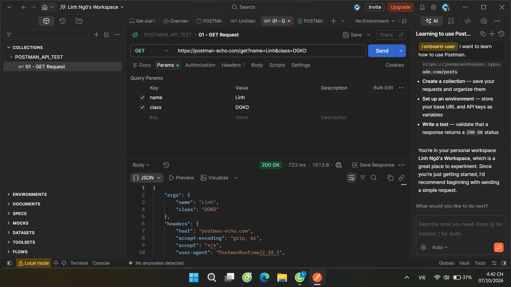
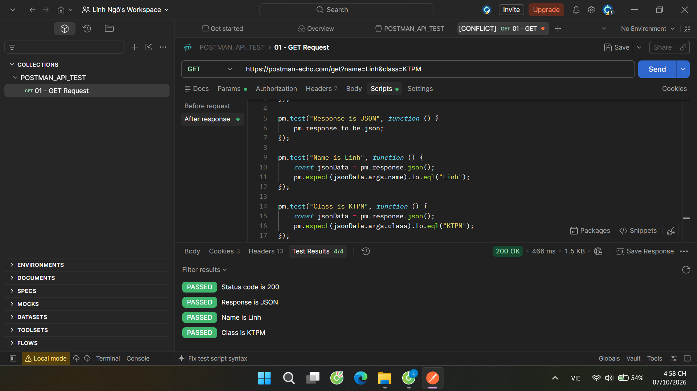
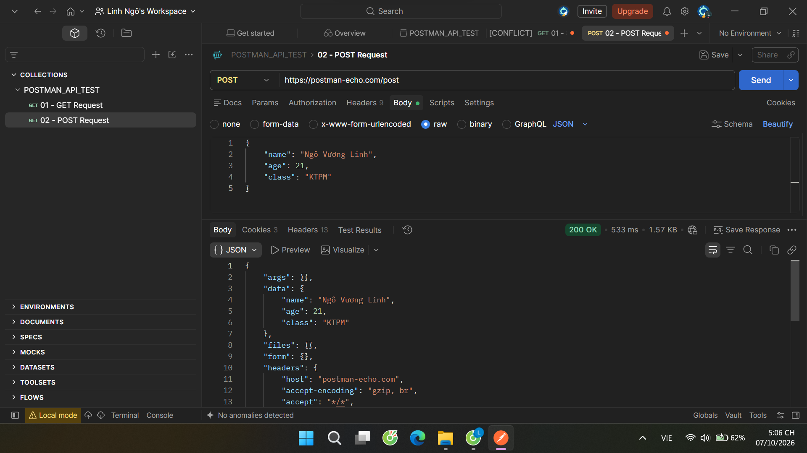
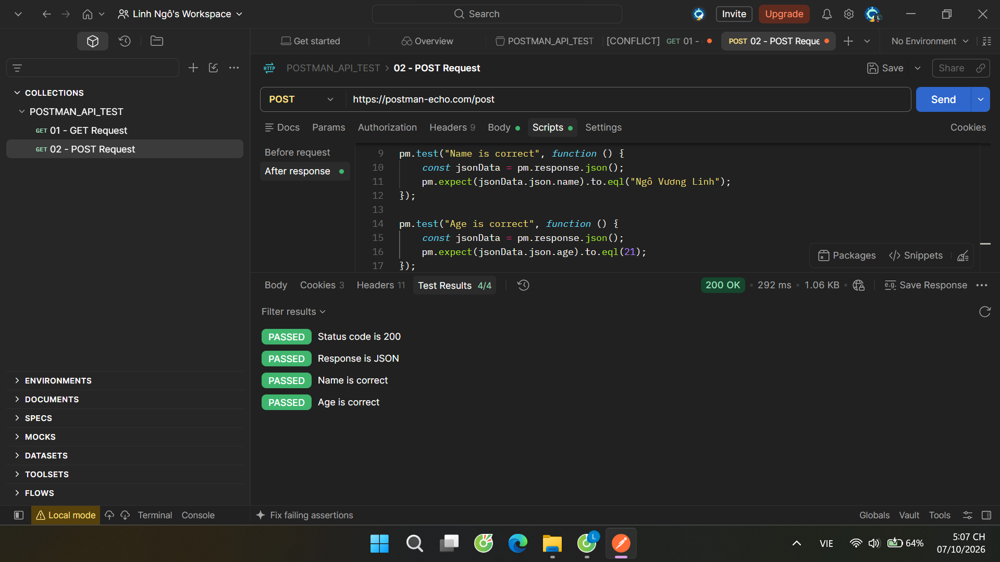
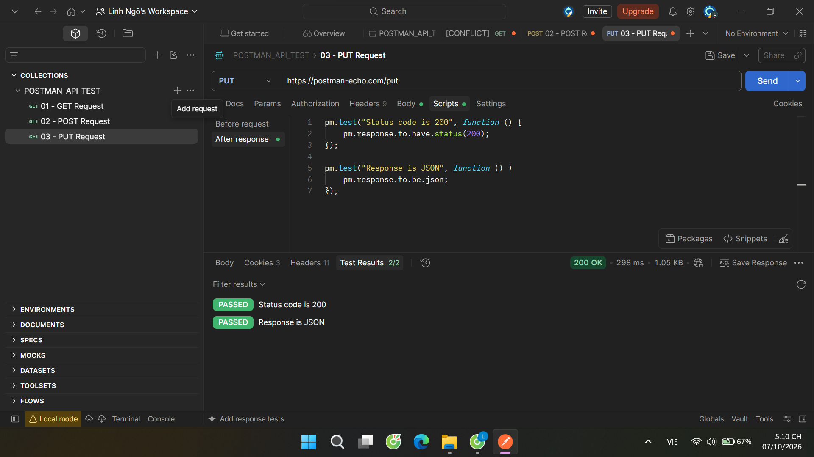
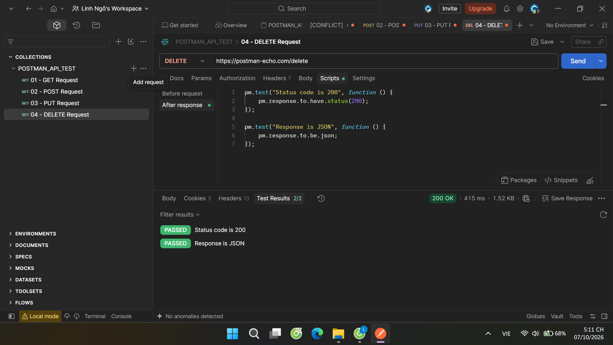
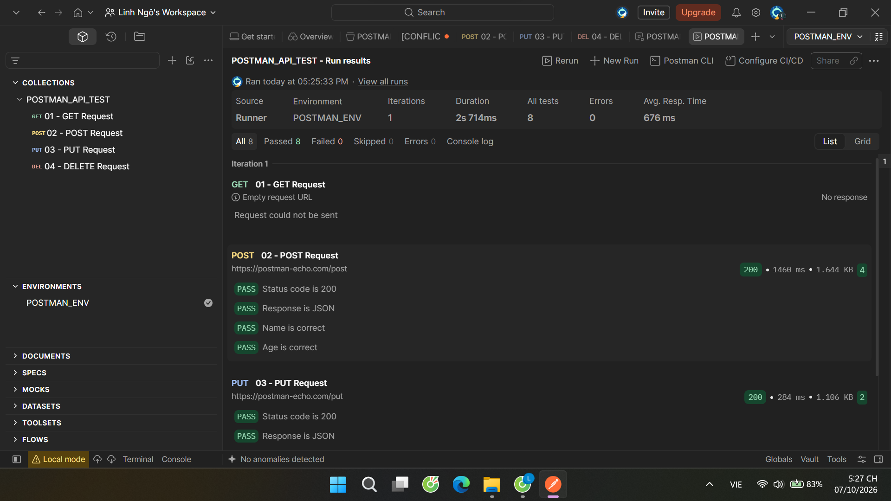
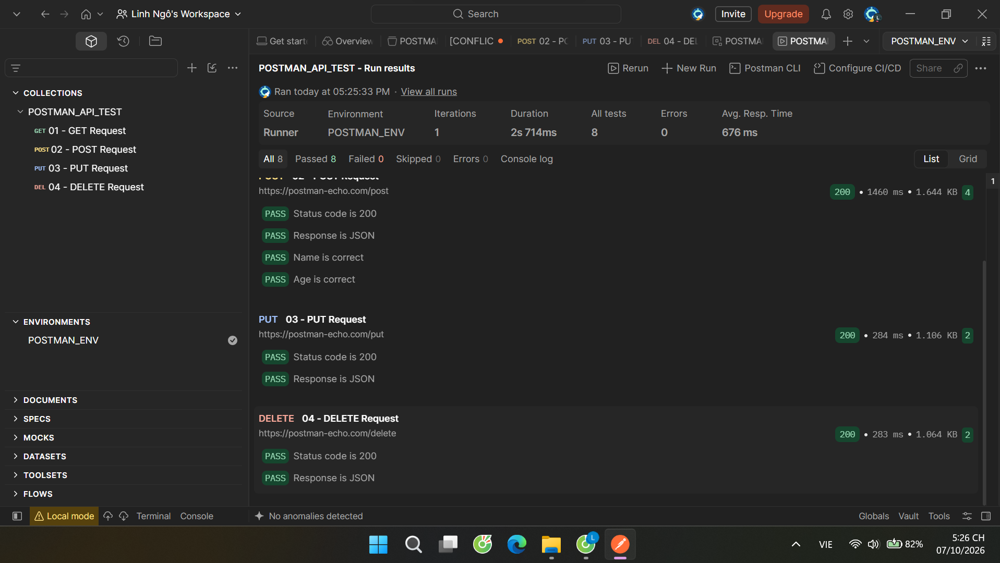

# Thực hành kiểm thử API với Postman

## 1. Thông tin sinh viên

| Thông tin | Nội dung |
|---|---|
| Họ và tên | Ngô Vương Linh |
| Lớp | Đánh giá kiểm định |
| MSSV | 23010496 |


## 2. Mục tiêu

- Làm quen với giao diện và các chức năng cơ bản của Postman.
- Gửi request HTTP bằng các phương thức GET, POST, PUT và DELETE.
- Truyền tham số truy vấn và dữ liệu JSON trong request.
- Viết kiểm thử tự động để xác nhận mã trạng thái, định dạng và nội dung response.
- Sử dụng Environment để quản lý URL cơ sở và Collection Runner để chạy nhiều request.

## 3. Giới thiệu Postman

Postman là công cụ hỗ trợ xây dựng, gửi và kiểm thử request API. Trong bài thực hành này, các request được tổ chức trong collection `POSTMAN_API_TEST`; dữ liệu phản hồi được kiểm thử bằng script JavaScript chạy sau mỗi request.

Bài thực hành sử dụng dịch vụ [Postman Echo](https://postman-echo.com/) để phản hồi thông tin request, phù hợp cho việc kiểm tra phương thức HTTP, query parameter và JSON body.

## 4. HTTP Method

| Method | Mục đích | Thực hành trong bài |
|---|---|---|
| GET | Lấy dữ liệu hoặc kiểm tra tham số gửi lên; thông thường không làm thay đổi dữ liệu trên server. | `/get?name=Linh&class=KTPM` |
| POST | Gửi dữ liệu trong request body, thường dùng để tạo tài nguyên. | `/post` với JSON thông tin sinh viên |
| PUT | Gửi dữ liệu để cập nhật hoặc thay thế tài nguyên. | `/put` với JSON thông tin sinh viên |
| DELETE | Yêu cầu xóa tài nguyên. | `/delete` |

Các endpoint Echo trong bài dùng để minh họa và phản hồi request; không nên hiểu kết quả này là dữ liệu đã được tạo, cập nhật hoặc xóa trong một hệ thống nghiệp vụ thật.

## 5. Thực hành GET

- **URL:** `https://postman-echo.com/get`
- **Query parameters:**
  - `name=Linh`
  - `class=KTPM`
- **Kiểm thử tự động:** HTTP status `200`, response là JSON, `args.name` bằng `Linh`, `args.class` bằng `KTPM`.
- **Kết quả chụp được:** 4/4 kiểm thử đạt.





## 6. Thực hành POST

- **URL:** `https://postman-echo.com/post`
- **Body (raw JSON):**

```json
{
  "name": "Ngô Vương Linh",
  "age": 21,
  "class": "KTPM"
}
```

- **Kiểm thử tự động:** HTTP status `200`, response là JSON, tên và tuổi trong `json` khớp với dữ liệu gửi đi.
- **Kết quả chụp được:** 4/4 kiểm thử đạt.





## 7. Thực hành PUT

- **URL:** `https://postman-echo.com/put`
- **Body:** JSON thông tin sinh viên gồm `name`, `age` và `class`.
- **Kiểm thử tự động:** HTTP status `200` và response là JSON.
- **Kết quả chụp được:** 2/2 kiểm thử đạt.



## 8. Thực hành DELETE

- **URL:** `https://postman-echo.com/delete`
- **Kiểm thử tự động:** HTTP status `200` và response là JSON.
- **Kết quả chụp được:** 2/2 kiểm thử đạt.



## 9. Kiểm thử tự động

Các script được đặt trong phần **Scripts → After response**. Những nội dung đã kiểm tra gồm:

- Mã trạng thái HTTP trả về.
- Response có định dạng JSON.
- Giá trị các trường trong response có khớp dữ liệu gửi đi hay không.

Ví dụ kiểm tra status và định dạng JSON:

```javascript
pm.test("Status code is 200", function () {
    pm.response.to.have.status(200);
});

pm.test("Response is JSON", function () {
    pm.response.to.be.json;
});
```

## 10. Environment

Environment được đặt tên `POSTMAN_ENV` và khai báo biến `baseUrl`, dự kiến dùng giá trị:

```text
baseUrl = https://postman-echo.com
```

Các request POST, PUT và DELETE sử dụng `{{baseUrl}}` trong URL. Khi chạy, chọn `POSTMAN_ENV` ở bộ chọn Environment của Postman.

**Lưu ý:** file environment hiện có trong dự án để giá trị `baseUrl` trống. Hãy điền giá trị trên trước khi chạy collection để các request dùng biến này có thể gửi thành công.

## 11. Collection Runner

Collection `POSTMAN_API_TEST` gồm bốn request theo thứ tự GET, POST, PUT và DELETE. Để chạy:

1. Chọn collection `POSTMAN_API_TEST`.
2. Mở **Run** hoặc **Collection Runner**.
3. Chọn Environment `POSTMAN_ENV`.
4. Chạy collection và xem số lượng kiểm thử đạt, thất bại cùng lỗi request.

Ảnh kết quả Runner ghi nhận một iteration, **8 kiểm thử đạt**, **0 thất bại** và **0 lỗi** trong khoảng 2,714 giây.





> Trong ảnh Runner, request GET có trạng thái **Empty request URL / Request could not be sent**. Vì vậy, 8 kiểm thử đạt ở lần chạy đó là các kiểm thử của POST, PUT và DELETE; GET đã được kiểm thử riêng thành công 4/4 như ảnh ở mục 5, nhưng chưa được chạy thành công trong collection run được chụp.

## 12. Kết quả

| Request | Kiểm thử riêng ghi nhận | Kết quả trong ảnh Runner |
|---|---:|---|
| GET | 4/4 đạt | URL rỗng, request không được gửi |
| POST | 4/4 đạt | 4 kiểm thử đạt |
| PUT | 2/2 đạt | 2 kiểm thử đạt |
| DELETE | 2/2 đạt | 2 kiểm thử đạt |
| **Collection Runner** | — | **8 đạt, 0 thất bại, 0 lỗi** |

Các ảnh request riêng cho thấy cả bốn phương thức đều nhận status `200 OK`; các script kiểm thử tương ứng đều đạt. Để kết quả Collection Runner bao gồm GET, cần lưu URL GET thành `{{baseUrl}}/get` (và giữ các query parameter `name=Linh`, `class=KTPM`), đồng thời điền `baseUrl` trong Environment.

## 13. Nhận xét

- Đã thực hành được bốn HTTP method phổ biến và cách gửi query parameter, JSON body.
- Các assertion giúp kiểm tra response tự động, giảm việc xác nhận thủ công.
- Environment giúp tái sử dụng URL cơ sở giữa các request.
- Các kết quả riêng lẻ đều đạt; tuy nhiên, cấu hình được lưu cho GET và giá trị `baseUrl` hiện còn thiếu, nên cần cập nhật trước khi chạy lại toàn bộ collection để có báo cáo nhất quán.
- Postman Echo chỉ phản hồi để phục vụ thực hành, không thay thế API nghiệp vụ thực tế.

## 14. Tài liệu tham khảo

1. [Postman Echo](https://www.postman-echo.com/) — dịch vụ dùng trong bài thực hành.
2. [Postman Learning Center](https://learning.postman.com/) — tài liệu chính thức về Postman.
3. [Postman: Writing tests](https://learning.postman.com/docs/tests-and-scripts/write-scripts/test-scripts/) — viết test script cho response.
4. [Postman: Manage environments](https://learning.postman.com/docs/sending-requests/variables/managing-environments/) — quản lý Environment và biến.
5. [RFC 9110: HTTP Semantics](https://www.rfc-editor.org/rfc/rfc9110) — đặc tả ngữ nghĩa HTTP.
